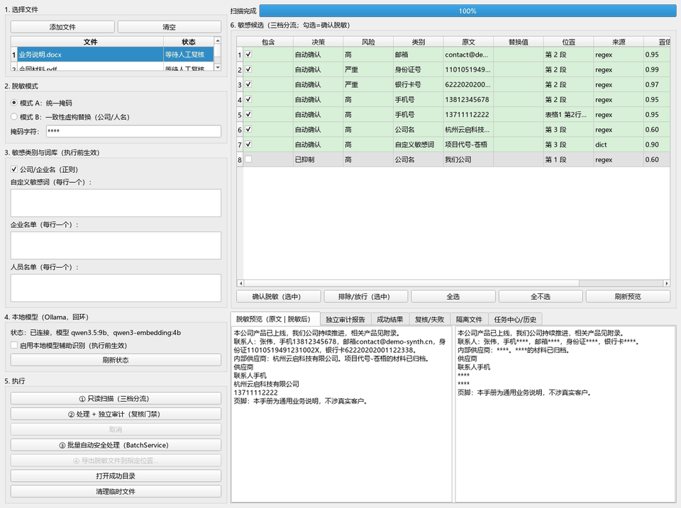

# LocalDocMask

> 本地优先、失败关闭的 Windows 文档脱敏与独立审计工具。文件不上传，敏感信息在离开你的电脑前完成识别、脱敏和复核。

[](https://www.python.org/)
[](https://www.microsoft.com/windows)
[](LICENSE)



## 快速开始

一行安装（PowerShell 7）：

```powershell
git clone https://github.com/YangWei-Ljj/LocalDocMask.git; cd LocalDocMask; py -3.11 -m venv .venv; .\.venv\Scripts\python.exe -m pip install -r requirements.txt
```

三行启动：

```powershell
cd LocalDocMask
.\.venv\Scripts\python.exe scripts\health_check.py --data-dir .\data
.\.venv\Scripts\python.exe main.py
```

> 模型文件体积较大且不随 Git 仓库分发。缺少模型时应用会以降级状态继续使用规则、词库和 OCR 路径。

## 解决的痛点

- 不想把合同、客户台账、员工信息上传到云端 SaaS。
- 普通“查找替换”无法覆盖页眉页脚、批注、隐藏表、图片、元数据和嵌入对象。
- 担心处理失败后仍把未检查内容导出为“成功文件”。
- 需要可复核、可追溯、可验证的脱敏结论，而不是只看一次替换结果。

LocalDocMask 支持 PDF、DOCX、XLSX/XLSM、PNG、JPEG、TIFF 和 BMP。

## 当前发布状态

**当前候选发布状态的唯一来源：**

`dist/t9-evidence/release-summary.json`

README、验收矩阵和最终报告不维护第二套实时发布状态。当前候选仍需完成：

- 独立干净 Windows VM 验证；
- 独立普通用户登录 ACL 验证；
- 旧版二进制回滚验证。

在 `release-summary.json` 的 `status` 为 `passed` 且三项外部检查均为布尔 true 之前，`production_release=false`，不得宣称已正式生产发布。

运行与验收流程见 `docs/operations/release_runbook.md`。

## 核心能力

- 原件只读，处理前后强制校验源文件 SHA-256。
- 高精度规则、上下文、词库和本地批准 NER 模型共同产生候选。
- 三档处置：自动确认、人工复核、抑制放行。
- 未裁决候选、审计失败、无法检查或产物哈希异常均失败关闭。
- PDF/DOCX 支持 OCR、文本、元数据和隐藏内容审计；XLSX 支持文本、元数据和隐藏内容审计；图片执行 OCR 审计。
- 本地 NER 默认启用已批准模型；模型缺失、损坏或推理失败时健康状态降级并失败关闭。
- 模式 A 使用统一掩码；模式 B 仅在内存中维护一致性虚构映射。明文磁盘映射已禁用，`disk` 配置会拒绝启动。
- scan/process/audit 使用 GuardedWorker 子进程硬超时；超时终止并隔离未确认产物。
- 最终成功产物和审计 JSON 通过原子流程写入受控 success 目录。

## 本地运行

```powershell
.venv\Scripts\python.exe main.py
```

正常无参数启动进入 GUI。`LocalDocMask.exe --release-self-check <输出目录>` 是仅用于自动验收的隐藏入口，不接受用户文件输入。

## 安全边界

- 不提供云上传、远程 Web 上传或遥测。
- Ollama 仅允许本机回环且默认关闭。
- OCR 与批准 NER 模型均在本机运行。
- 审计 JSON 不写入原始敏感值、原始文件名或用户路径。
- 审计 findings 只保留 verdict、scope、稳定 ID 和安全摘要。
- 审计 JSON 与 `policy_version`、`config_hash`、`tool_version` 以及源/输出 SHA-256 绑定。

## 构建与质量

```powershell
powershell -NoProfile -ExecutionPolicy Bypass -File scripts\build_package.ps1 -VerifyReproducible
```

构建前必须工作区干净。构建会执行可重复构建、隔离启动 smoke 和打包后完整 E2E，并生成 SBOM、校验清单、`build.json` 与 `package-e2e.json`。

SBOM 只包含 `pyproject.toml` 运行时依赖闭包，不枚举开发工具或无关虚拟环境包。

质量评测结果见 `docs/quality_report.md`。合成评测与历史基线的指标不代表真实生产文档精度，也不构成发布状态来源。

## License

本项目采用 [MIT License](LICENSE)。
