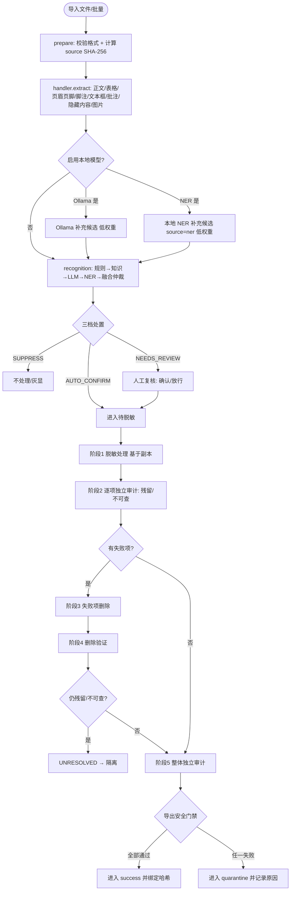
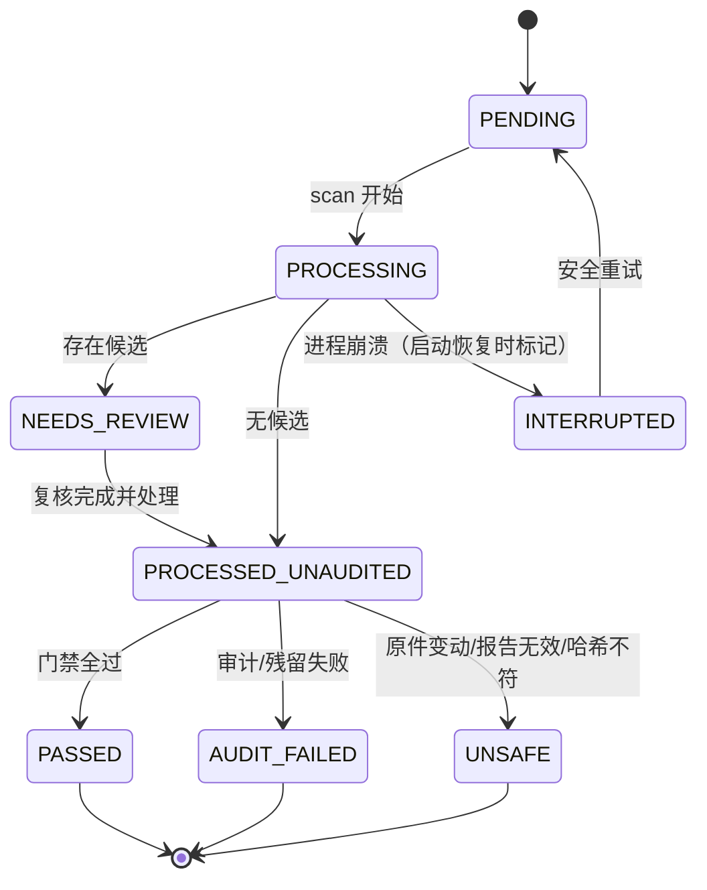
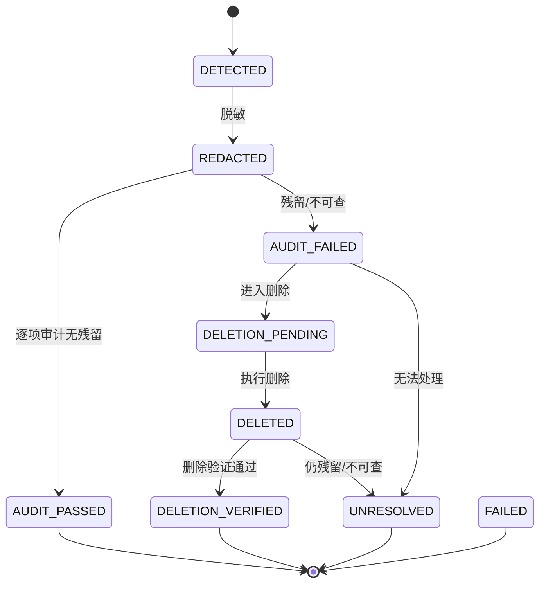

# LocalDocMask 数据流与状态机

> 版本：v1.0 日期：2026-10-26
> 说明：在现有流水线（`task_manager.py`）基础上的目标数据流，保留已验证的安全门禁，新增上下文判定、融合分流、批次一致性与持久化。

## 1. 端到端数据流（Mermaid）

## 2. 任务状态机（TaskStatus）

- `INTERRUPTED` 为新增状态：启动时对"处理中但无活动进程"的任务标记，不自动认定安全。
- 现有 7 态保留：PENDING/PROCESSING/NEEDS_REVIEW/PROCESSED_UNAUDITED/AUDIT_FAILED/UNSAFE/PASSED。

## 3. 条目状态机（ItemStatus）

## 4. 识别三档分流（融合输出）

| 处置 | 实体示例 | 来源/置信度 | 结果 |
|---|---|---|---|
| AUTO_CONFIRM | 身份证、手机、邮箱、银行卡、黑名单命中 | 高精度规则/校验通过 | confirmed=True，直接脱敏 |
| NEEDS_REVIEW | 真实公司名、公开企业名、姓名、地址、模型独有项 | 上下文相关/中等置信度/冲突 | 待用户裁决 |
| SUPPRESS | 我们公司、有限公司、股份公司、集团公司、银行医院大学、白名单命中 | 泛指/非实体 | 不脱敏 |

泛指判定（context）：取候选去掉组织后缀后的"核心"，若核心为空、仅由泛指词（我们/本/该/贵/有限/股份/集团/总/分…）或组织类词（银行/医院/大学/研究院…）构成，则判为泛指引用。

### 4.1 本地 NER 可选支路（ADR-009）

- `ner.enabled` 默认 false；组合根仅在启用时惰性构造 `OnnxChineseNER`（onnxruntime 本地推理，运行时零网络）。
- NER 输出以 `source="ner"` 进入候选池，与 ollama 同口径低权重：**仅**模型来源（无 regex/dict/blacklist/domain 印证）的上下文类实体一律转 NEEDS_REVIEW；NER 不参与"是否残留/可否导出"的最终判定。
- 任何 NER 异常、缺依赖或缺模型文件：组合根/pipeline 捕获并降级为不启用，主流程照常。标签映射 PER→姓名、ORG→公司名、LOC→详细地址。

## 5. 导出安全门禁（finalize，全部为 AND）

1. 原件当前 SHA-256 == 处理前 `source_hash`（原件未被原地修改）。
2. 审计报告是真实审计对象（`task.audit is report`）且 findings 非空。
3. 输出文件存在且可打开。
4. 输出当前 SHA-256 == 审计后绑定的 `final_hash`（审计后未被篡改）。
5. 无 `UNRESOLVED` 条目。
6. 审计报告 `passed=True`（所有结论为 NO_RESIDUAL）。
7. 复核门禁：
   - 交互模式：无未裁决的 NEEDS_REVIEW 项；
   - 批量自动模式：文件不得含 NEEDS_REVIEW 项，否则保持"待复核"，不自动导出。

任一不满足 → 不进入 success：审计类失败标 AUDIT_FAILED，完整性/可信度类失败标 UNSAFE，输出与报告移入 quarantine 并记录阶段与原因。

## 6. 批次一致性（模式 B）

- 一个批次共享一个 `ConsistencyMapper`（scope=batch），同一真实实体在该批次所有文件中映射为同一虚构值。
- 映射默认仅内存；冲突自动取下一个未占用虚构值；映射不进日志/报告。

## 7. 持久化与幂等

- 任务/条目/审计/操作落 SQLite；原文不入库，仅哈希与掩码值。
- 幂等键：（源 SHA-256 + 模式 + 策略版本）；命中已验证成功产物可复用/跳过。
