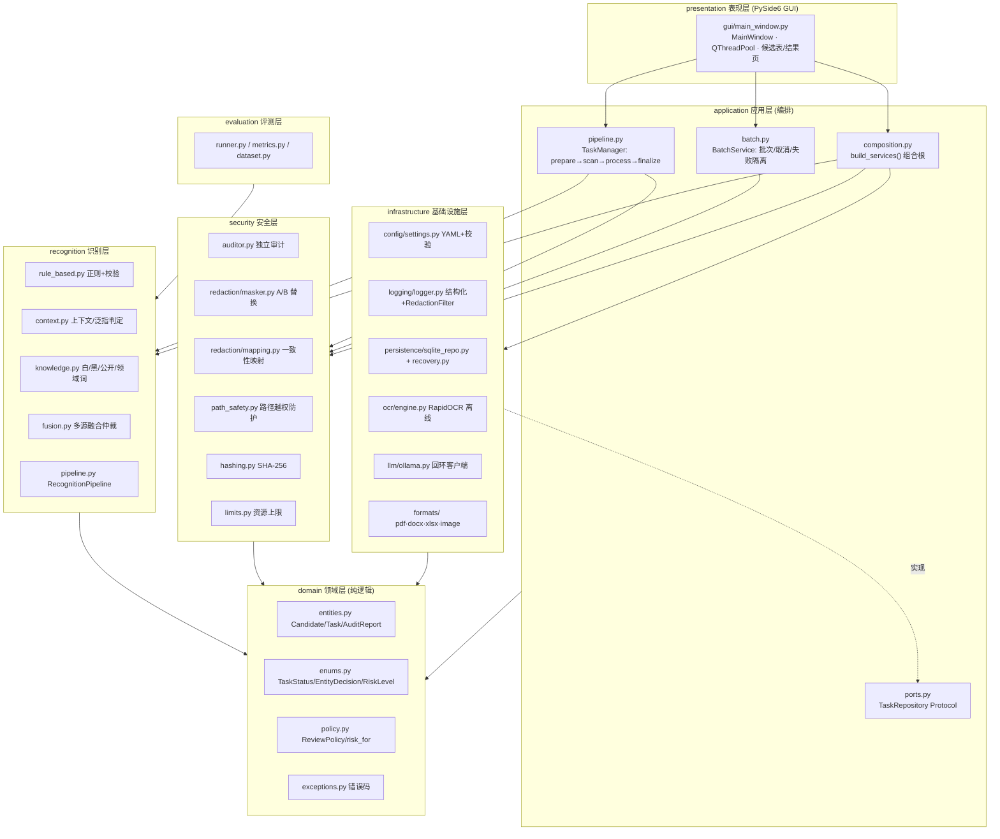
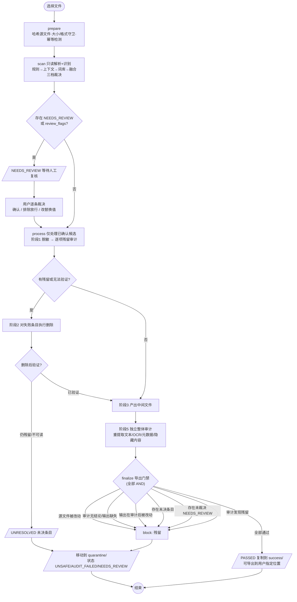
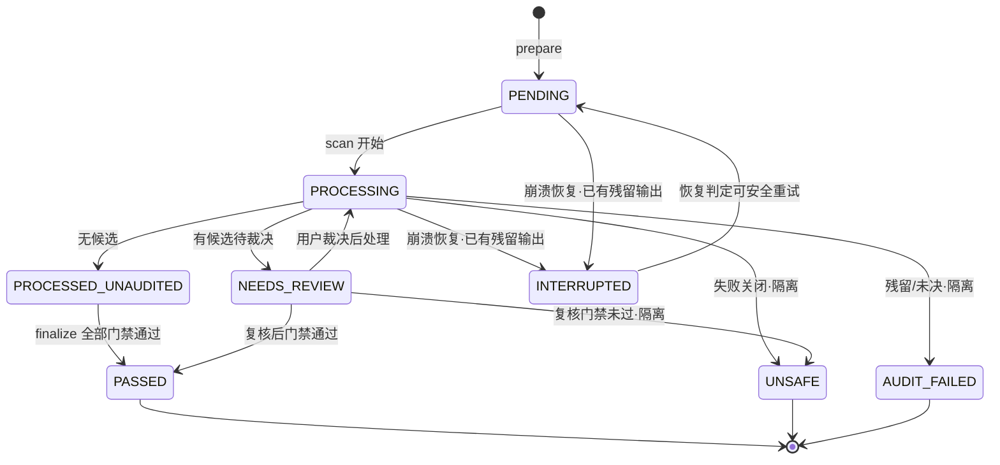
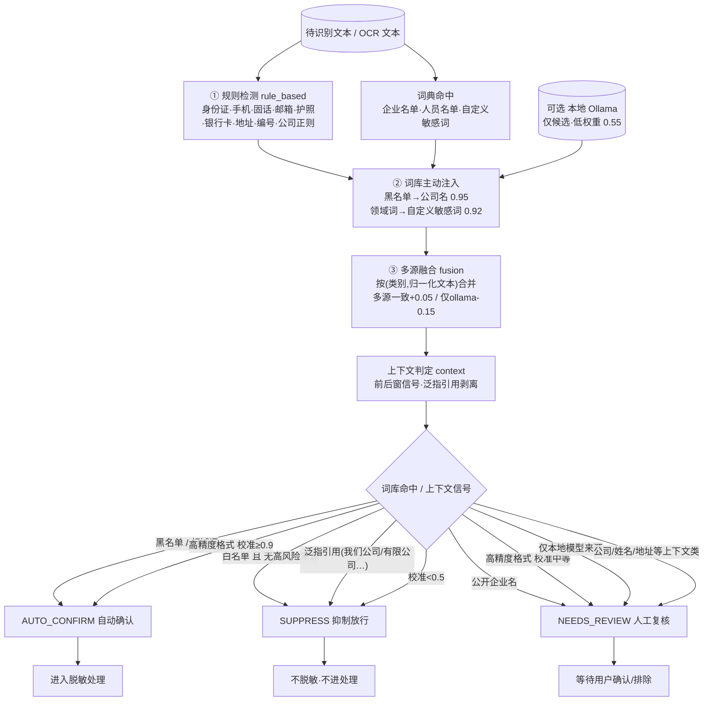
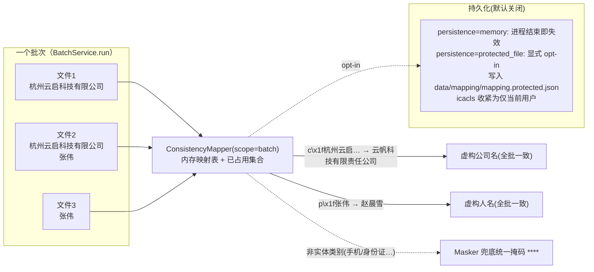

# LocalDocMask 架构与业务流程图

> 本文件所有图均以 `master` 分支当前代码（`src/localdocmask/`）为依据绘制。
> 包结构对应 ADR-001，识别融合对应 ADR-002/003，模式 B 映射对应 ADR-004，
> 持久化对应 ADR-005，日志对应 ADR-008。图与代码不一致时以代码为准。

---

## 1. 分层架构与依赖方向

外层依赖内层；`domain` 不依赖任何业务包；应用层只依赖自身定义的端口（Protocol），
具体基础设施实现由唯一的组合根 `application/composition.py::build_services()` 装配并注入。

依赖规则（与 ADR-001 一致）：

- `domain` 不 import 任何其他业务包或重框架，只做纯数据结构与策略。
- `application` 通过构造注入拿到 `RecognitionPipeline / Auditor / repository / settings`，
  不直接 `new` 具体基础设施；`composition.py` 是唯一允许 `new` 出基础设施实现的地方。
- `presentation` 只调 `build_services()` 返回的服务集合，不直接 `new Detector/TaskManager/OllamaClient`。

---

## 2. 端到端业务流程（含任务状态机与失败关闭/隔离分支）

实线为正常成功路径；红色分支为失败关闭路径（一律进隔离目录 `data/output/quarantine/`，绝不导出）。

**任务状态机**（`domain/enums.py::TaskStatus`）：

失败关闭原则：任何一条门禁不通过，产物被 `shutil.move` 移入隔离目录并记录原因，
**不会**被当作成功输出；崩溃后已产出但未审计的文件标记为 `INTERRUPTED`，不自动认定安全。

---

## 3. 识别三档分流（规则 → 上下文 → 词库 → 融合 → 三档）

对应 `recognition/` 包与 `domain/policy.py`。先保召回（规则命中即入候选），
再用上下文/词库/融合精过滤，最后按类别+来源+校准置信度分流。

判定理由写入 `Candidate.decision_reason`，在候选表"判定理由"列对用户可见，保证每条结论可解释。

---

## 4. 模式 B 一致性虚构映射示意

对应 `security/redaction/mapping.py::ConsistencyMapper`。真实实体 → 稳定虚构值；
同一批次内跨文件一致；映射表默认仅内存不落盘。

冲突处理：分配采用确定性序列，维护"已占用虚构值"集合；若候选值已被占用则顺延下一个，
**绝不静默复用**；无法分配时抛 `MappingCollisionError` 使该文件失败关闭。
映射表严禁写入日志/报告/数据库，`__repr__` 只返回条目数。
