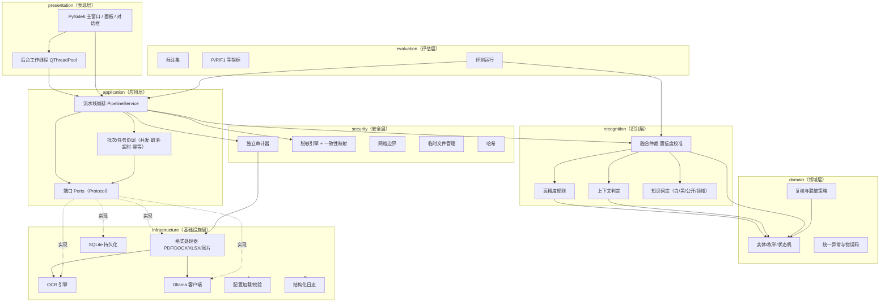

# LocalDocMask 目标架构

> 版本：v1.0 日期：2026-10-26
> 依据：`docs/project_audit/localdocmask_current_state.md`、`docs/project_audit/repomind_baseline.md`、`docs/decisions/ADR-001~008`

## 1. 产品定位

企业级、本地优先、面向混合格式文档的智能隐私治理与安全脱敏平台。完整业务闭环：

```
文件接入 → 内容解析 → 敏感信息识别 → 上下文判定 → 风险融合 → 人工复核
       → 脱敏处理 → 独立验证 → 安全导出 → 审计报告
```

## 2. 逻辑架构（Mermaid）



## 3. 物理包布局（目标）

```
src/localdocmask/
├── __init__.py
├── __main__.py
├── domain/
│   ├── enums.py            # TaskStatus/ItemStatus/AuditVerdict/RiskLevel/EntityDecision
│   ├── entities.py         # Candidate/ScanResult/AuditFinding/AuditReport/Task
│   ├── exceptions.py       # LocalDocMaskError + 子类 + ErrorCode
│   └── policy.py           # 复核策略、风险阈值、默认处置（纯逻辑）
├── recognition/
│   ├── patterns.py         # 高精度正则与校验器
│   ├── rule_based.py       # 规则检测器
│   ├── context.py          # 上下文窗口、泛指引用判定
│   ├── knowledge.py        # 词库文件加载与匹配
│   └── fusion.py           # 多源融合、置信度校准、仲裁、三档分流
├── application/
│   ├── ports.py            # ContentHandler/LLM/OCR/Auditor/Repository/Mapper 端口
│   ├── pipeline.py         # 端到端编排（原 task_manager 逻辑）
│   └── batch.py            # 批次协调、并发/取消/超时/幂等
├── infrastructure/
│   ├── config/settings.py  # YAML + dataclass 校验
│   ├── logging/logger.py   # 结构化日志 + 敏感值过滤
│   ├── persistence/sqlite_repo.py
│   ├── ocr/engine.py
│   ├── llm/ollama.py
│   └── formats/
│       ├── base.py / registry.py
│       ├── pdf.py / docx.py / xlsx.py / image.py
├── security/
│   ├── hashing.py
│   ├── network.py
│   ├── tempfiles.py
│   ├── auditor.py
│   └── redaction/
│       ├── masker.py
│       └── mapping.py      # ConsistencyMapper（作用域/持久化/冲突/保护）
├── presentation/
│   └── gui/
│       ├── main_window.py
│       ├── workers.py
│       ├── panels/
│       └── dialogs/
└── evaluation/
    ├── dataset.py
    ├── metrics.py
    └── runner.py
```

配套资源：

```
config/config.example.yaml      # 提交；config/config.yaml 用户实际（gitignore）
resources/whitelist.txt         # 明确非敏感
resources/blacklist.txt         # 始终敏感
resources/public_entities.txt   # 公开企业/机构/高校
resources/domain_terms.txt      # 领域/内部专有名词
```

## 4. 依赖规则（强约束）

- 依赖方向：`presentation → application → domain`；`recognition → domain`；`security → domain`（经端口使用基础设施）；`infrastructure → domain`（实现端口）；`evaluation → recognition/application`。
- `domain` 不 import 任何业务包与重框架。
- `application` 仅依赖 `domain` 与 `ports`，具体实现构造注入，便于测试与替换。
- 禁止循环依赖；禁止跨层直接 new 具体实现（表现层不直接 new Detector/LLM）。

## 5. 关键横切机制

| 机制 | 位置 | 要点 |
|---|---|---|
| 安全默认/失败关闭 | domain/policy + application/pipeline | 失败/超时/状态不明禁止导出 |
| 原件保护 | security/hashing | 处理前/导出前 SHA-256 比对 |
| 独立验证 | security/auditor | 重提取文本/OCR/元数据/隐藏部件 |
| 网络边界 | security/network | 仅回环、禁代理、白名单可审计 |
| 临时文件 | security/tempfiles | 受控目录、最小权限、清理与崩溃核查 |
| 配置/日志/持久化 | infrastructure | 见 ADR-005/006/008 |

## 6. 非目标（明确不做）

不引入多 Agent、向量 RAG/向量库、MCP、Redis、消息队列、微服务、Docker（论证见 ADR-007）。技术复杂度与真实收益匹配。
